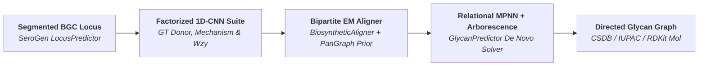

# KBank

<div class="sv-hero" markdown>

<div class="sv-hero-eyebrow" markdown="span">:lucide-hexagon: SeroVerse · Geno-Glycomic Engine</div>

# KBank

**Neuro-symbolic bacterial glycan database, biosynthetic gene-to-glycan alignment, and *de novo* polysaccharide structure prediction.**

Built on Structure-of-Arrays (SoA) Compressed Sparse Row (CSR) chemical graphs and Numba-accelerated message-passing kernels, **KBank** bridges [`SeroGen`](https://seroverse.github.io/SeroGen/) biosynthetic gene cluster predictions directly to chemical polysaccharide structures (`CSDB` / `IUPAC` / RDKit `Mol`).

<div class="sv-badges">
  
  
  
  
</div>

</div>

---

## Key Capabilities

<div class="grid cards" markdown>

-   :lucide-database: **Curated Geno-Glycomic Database (`kbank.db`)**

    ---

    Provides **1,514** curated bacterial polysaccharide structures (`CSDB` and `IUPAC` Linear) paired with complete biosynthetic gene clusters and MCL protein homology families across *Klebsiella*, *Acinetobacter*, *Escherichia*, *Salmonella*, *Streptococcus*, and *Pseudomonas*.

-   :lucide-hexagon: **CSR Directed Glycan Graphs (`kbank.glycan`, `kbank.sugars`)**

    ---

    Represents repeating-unit oligosaccharides and modifications inside contiguous SoA CSR arrays with root-invariant topological hashing, Weisfeiler-Lehman graph kernels, and direct CSDB/IUPAC parsing and serialization.

-   :lucide-git-compare: **Bipartite Gene-to-Glycan Alignment (`kbank.biosynthesis.align`)**

    ---

    Maps individual glycosyltransferases, acetyl/pyruvyltransferases, and `Wzy` polymerases onto specific sugar linkages via `BiosyntheticAligner` and `PanGraphConsensusPrior` Expectation-Maximization homology priors.

-   :lucide-network: **Neuro-Symbolic *De Novo* Structure Prediction (`kbank.biosynthesis.predictor`)**

    ---

    Combines Operon Precursor Pool gating, factorized 1D-CNN enzyme classifiers (`BiosyntheticClassifierSuite`), a 2-layer Relational Message-Passing GNN (`RelationalMPNN`), and a branch-and-bound Constrained Spanning Arborescence solver (`GlycanPredictor`).

</div>

---

## End-to-End Geno-Glycomic Pipeline



---

## Quickstart

=== "De Novo Glycan Structure Prediction"

    ```python
    from kbank.biosynthesis.predictor import GlycanPredictor
    from kbank.db.records import GlycanRecords
    from serogen.core.io.fasta import GenomeAssembly
    from serogen.loci.predictor import LocusPredictor

    # Load curated bacterial glycan-locus reference database
    records = GlycanRecords.load()

    # Segment capsule/O-antigen locus from a genome assembly
    assembly = GenomeAssembly.from_fasta("KL106.fasta")
    locus = LocusPredictor().predict(assembly)[0]

    # Predict top candidate polysaccharide structures via Relational MPNN
    predictor = GlycanPredictor.from_records(records)
    top_hit = predictor.predict(locus, top_k=1)[0]
    print(top_hit.glycan.to_csdb().decode(), f"(p={top_hit.probability:.2%})")
    ```

=== "CSDB & IUPAC Glycan Graph Parsing"

    ```python
    from kbank.io.csdb import CSDBParser
    from kbank.io.iupac import IUPACParser

    csdb_parser = CSDBParser()
    glycan = csdb_parser.parse("-3)[bDGlcpA(1-2)aLRhap(1-3)]aDGalp(1-")

    print(f"Residues: {glycan.num_nodes}, Linkages: {glycan.num_edges}")
    ```

=== "Bipartite Gene-to-Glycan Alignment"

    ```python
    from kbank.biosynthesis.align import BiosyntheticAssigner
    from kbank.db.records import GlycanRecords

    records = GlycanRecords.load()
    assigner = BiosyntheticAssigner()

    # Align a biosynthetic gene cluster to its paired glycan structure
    record = records[0]
    assignment = assigner.assign_record(record.glycan, record.locus)
    ```
